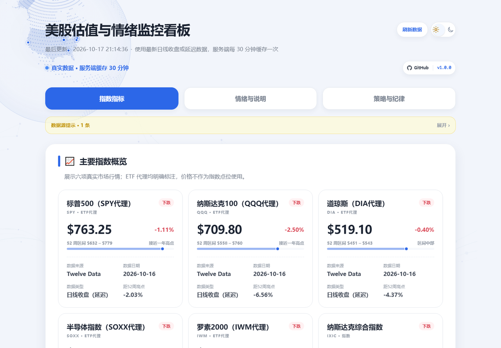
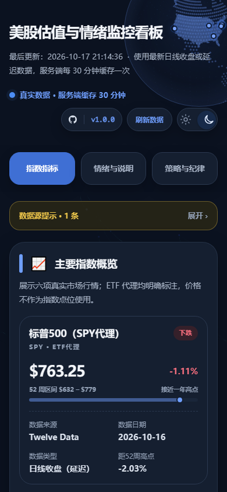

# 美股估值与情绪监控看板

[](https://github.com/fomalhaut1998/us-market-dashboard/releases)
[](LICENSE)
[](https://nextjs.org)
[](https://nodejs.org)

一个用 Next.js 16 构建的美股大盘位置与情绪看板：把指数行情、相对强弱、波动率结构、恐惧贪婪、估值分位、市场宽度、信用利差放在同一屏，再按固定规则给出定投倍率提示。

- **在线演示**：<https://us-market-dashboard-gules.vercel.app>
- **源码仓库**：<https://github.com/fomalhaut1998/us-market-dashboard>
- **发布记录**：<https://github.com/fomalhaut1998/us-market-dashboard/releases>
- **更新日志**：[CHANGELOG.md](CHANGELOG.md)

> 本项目只做数据展示与研究记录，不构成任何投资建议。据此操作，风险自负。





## 目录

- [功能](#功能)
- [在线演示](#在线演示)
- [技术栈](#技术栈)
- [快速开始](#快速开始)
- [环境变量](#环境变量)
- [数据来源与延迟](#数据来源与延迟)
- [指标与倍率规则](#指标与倍率规则)
- [缓存、刷新与快照](#缓存刷新与快照)
- [API](#api)
- [部署](#部署)
- [项目结构](#项目结构)
- [开发脚本](#开发脚本)
- [常见问题](#常见问题)
- [版本与发布](#版本与发布)
- [贡献](#贡献)
- [数据与许可](#数据与许可)
- [免责声明](#免责声明)

## 功能

**指数指标**

- 六项行情：SPY、QQQ、DIA、SOXX、IWM 与纳斯达克综合指数，含 52 周区间、距 52 周高点、数据来源与数据日期。
- 相对强弱：各标的近 20 / 60 个交易日相对 SPY 的超额收益，用来判断行情是普涨还是少数权重在拉。
- 指数综合判断：估值、趋势位置、短期表现与操作提示。

**情绪与说明**

- 极端信号监控：VIX、CNN 恐惧贪婪、RSI(6)、标普 500 PE 近 5 年分位、52 周回撤、25 日涨跌幅；区分触发 / 观察 / 正常 / 数据陈旧。
- 波动率结构：9 天、30 天、3 个月 VIX，期限结构比值，以及 SKEW / VVIX 的 5 年分位。
- 市场宽度：RSP（标普 500 等权）与 SPY（市值权）的强弱差与比值分位。
- 信用市场：美国高收益债 OAS、5 年分位与 20 日变化。
- VIX / PE 历史走势与指标解释，每个面板都写明口径和注意事项。

**策略与纪律**

- 倍率规则：估值优先，信号触发 / 观察 / 互相确认分别对应不同倍率。
- 倍率轨迹：读取本地每日快照，按交易日去重展示倍率变化。
- 触发敏感性：每个信号离触发或退出还差多少。
- 纪律清单：把执行规则固定下来，避免临场改口径。

**体验与工程**

- 浅色 / 深色主题，默认按本地时间自动选择并记住选择。
- 移动端适配、粘性标签栏、冷启动骨架屏。
- 服务端 30 分钟缓存，手动刷新有 60 秒节流，避免打爆免费额度。
- 数据源失败时自动回退并显示提示；缺失指标不会用模拟值填充。
- 浏览器端缓存上一次成功读取的数据，冷启动时先展示旧数据再后台更新。
- 页头与页脚展示开源仓库、版本号、发布记录与许可信息。

## 在线演示

<https://us-market-dashboard-gules.vercel.app>

演示站由 Vercel 从 `main` 分支自动部署。演示环境没有持久化磁盘，倍率轨迹可能随实例重建而清空；本地或自建服务部署可以保留 `data/snapshots.jsonl`。

## 技术栈

- **Next.js 16**：App Router、Server Components、Route Handlers
- **React 19** + **TypeScript 6**（`strict`）
- **Tailwind CSS 4**
- 图表以 SVG / CSS 自绘，没有引入额外图表库
- 数据获取与缓存全部在服务端完成

## 快速开始

要求 Node.js **20.9+**（推荐 22 LTS）。

```bash
git clone https://github.com/fomalhaut1998/us-market-dashboard.git
cd us-market-dashboard

# 安装依赖（有 lockfile，CI 使用 npm ci）
npm ci

# 配置环境变量
cp .env.example .env.local      # Windows: copy .env.example .env.local

npm run dev
```

打开 <http://localhost:3000>。

不配置任何 key 也能启动：Cboe、CNN、Multpl 的公开页面仍可读取，但 Twelve Data 的行情会缺失，指数卡片可能为空。想看到完整面板，建议至少配置 `TWELVE_DATA_API_KEY`。

生产构建：

```bash
npm run build
npm run start
```

## 环境变量

复制 `.env.example` 为 `.env.local` 后填写。变量在运行时读取，修改后需要重启开发服务器或生产进程。

| 变量 | 必填 | 用途 |
| --- | --- | --- |
| `TWELVE_DATA_API_KEY` | 推荐 | SPY / QQQ / DIA / SOXX / IWM / IXIC 与 VIX 的日线。免费档约 8 credits/分钟，整页一次刷新会用到 7 个符号。 |
| `FMP_API_KEY` | 可选 | Twelve Data 不提供纳斯达克综合指数时，用 `^IXIC` 兜底。免费档可用范围有限。 |
| `FRED_API_KEY` | 可选 | 高收益债 OAS（`BAMLH0A0HYM2`）。不填会回退到 fredgraph CSV，速度较慢。免费申请：<https://fredaccount.stlouisfed.org/apikeys> |
| `TWELVE_DATA_NASDAQ_SYMBOL` | 可选 | 纳斯达克综合指数代码，默认 `IXIC`。 |
| `TWELVE_DATA_VIX_SYMBOL` | 可选 | VIX 代码，默认 `VIX`。 |
| `DASHBOARD_SNAPSHOT_FILE` | 可选 | 倍率轨迹快照路径，默认 `<项目根>/data/snapshots.jsonl`。只读文件系统或容器可指向可写目录。 |

## 数据来源与延迟

| 数据 | 来源 | 说明 |
| --- | --- | --- |
| 指数 / ETF 行情 | Twelve Data → Nasdaq → Financial Modeling Prep | 依次回退；Twelve Data 返回 429 后冷却 5 分钟，再失败则使用最近一次成功的数据。 |
| VIX、SKEW、VVIX | Cboe | 官方日线收盘。 |
| 恐惧贪婪 | CNN | 公开页面上的当前分数。 |
| 标普 500 PE | Multpl | 月度数据，只取非估算值；滞后超过 45 天时只标注、不参与倍率计算。 |
| 高收益债 OAS | FRED | `BAMLH0A0HYM2`，T+1 公布的日频数据。 |
| 市场宽度 | RSP / SPY | RSP 行情单独缓存 2 小时；SPY 走整页 30 分钟缓存。 |

所有行情都是日线收盘或延迟数据，**不是实时报价**。仓库不附带行情数据，运行时从上述公开来源获取；使用前请遵守各数据源的条款。

## 指标与倍率规则

### 六个极端信号

| 信号 | 观察什么 |
| --- | --- |
| VIX | 波动率绝对水平和阶段位置 |
| CNN Fear & Greed | 市场情绪是否走到极端 |
| RSI(6) | 超买 / 超卖，低置信度信号 |
| 标普 500 PE 近 5 年分位 | 估值是否处于历史高位 |
| 52 周回撤 | 距离一年高点有多远 |
| 25 日涨跌幅 | 短期是否涨得过急 |

信号状态分触发 / 观察 / 正常；数据超过有效期时标为陈旧，不参与判断。每个信号的含义、阈值和注意事项见页面「情绪与说明」中的指标说明。

### 倍率规则

倍率只由固定规则计算，不做预测：

- **估值优先**：标普 500 PE 近 5 年分位 **≥ 90% → 0.25×**，**≥ 80% → 0.5×**；PE 数据陈旧时不参与。
- 有 1 项高置信信号触发，或 2 项信号互相确认 → **2×**。
- 只有 RSI(6) 一项低置信信号触发 → **1.5×**；有信号进入观察区也记 **1.5×**。
- 其余情况维持 **1×**。

阈值集中在 [`src/config/thresholds.ts`](src/config/thresholds.ts)，信号置信度与倍率档位在 [`src/config/strategy.ts`](src/config/strategy.ts)。修改规则后请同步更新页面文案与测试预期。

## 缓存、刷新与快照

```text
公开数据源
  → src/lib/server（取数、回退、解析）
  → 指标计算与阈值判断（src/lib）
  → DashboardPayload
  → 服务端缓存 / Route Handler
  → React 看板
  → data/snapshots.jsonl（倍率轨迹）
```

- 服务端缓存 30 分钟；进程内还会复用同一个 Promise，并发请求不会重复抓取。
- 手动刷新走 `/api/dashboard?refresh=1`，服务端做 60 秒节流；页面上的「刷新数据」按钮也会触发一次强制刷新。
- 浏览器端把最近一次成功结果写入 `localStorage`（24 小时），服务端冷启动期间先显示旧数据。
- 每次有效计算会向 `data/snapshots.jsonl` 追加一条快照（本地文件，已在 `.gitignore` 中排除）；同一交易日以最后一条为准，策略页的倍率轨迹从这里读取。
- 首次冷启动需要抓取多个数据源，通常 10–20 秒；之后 30 分钟内直接读缓存。
- Serverless / 只读文件系统下写盘会失败，但不会影响页面展示；可用 `DASHBOARD_SNAPSHOT_FILE` 指向可写路径，或接受轨迹不持久化。

## API

### `GET /api/dashboard`

返回缓存中的 `DashboardPayload` JSON，`Cache-Control: no-store`。

### `GET /api/dashboard?refresh=1`

跳过缓存强制刷新，但服务端有 60 秒节流；节流窗口内的请求仍返回当前缓存。成功时同时回填内存缓存。

失败时返回 HTTP 503：

```json
{
  "error": "真实数据加载失败",
  "detail": "具体错误信息"
}
```

页面依赖的主要字段：`status`、`lastUpdated`、`indexSummaries`、`relativeStrength`、`sentimentMetrics`、`termStructure`、`tailRisk`、`breadth`、`creditSpread`、`vixPeHistory`、`strategyData`、`missingCount`、`notices`。

## 部署

### Vercel（推荐）

1. 在 Vercel 导入本仓库，Framework Preset 选择 Next.js。
2. 在 Project Settings → Environment Variables 配置 `TWELVE_DATA_API_KEY` 等变量。
3. 部署；`main` 分支更新会自动触发生产部署。

注意事项：

- Vercel 的文件系统只读，快照写入会失败；如需保留倍率轨迹，把 `DASHBOARD_SNAPSHOT_FILE` 指向 `/tmp/...`，但实例重建后会清空。
- 服务端缓存是进程内 / 实例级的；多实例部署时各自缓存，数据可能短暂不一致。
- 免费行情额度有限，整页刷新会用到 7 个符号，请勿频繁点击刷新。

### 自建 Node 服务

```bash
npm ci
npm run build
npm run start
```

- Node.js 20.9+；用进程管理器（systemd、PM2 等）守护。
- 为 `data/` 准备持久化磁盘，或设置 `DASHBOARD_SNAPSHOT_FILE`。
- 默认监听 3000 端口；可用 `PORT` 环境变量覆盖。
- 前面可以放 Nginx / Caddy 做 TLS 与域名，页面本身不需要额外的 CDN 才能运行。

## 项目结构

```text
src/app                   页面、布局与 /api/dashboard
src/components/dashboard  面板、图表、标签页与交互组件
src/config                阈值、策略、市场与站点元信息
src/data                  文案、地球点云等静态数据
src/lib                   指标计算与策略判断
src/lib/server            取数、缓存、备用源、数据组装与快照
src/types                 数据类型
docs/screenshots          README 截图
data/snapshots.jsonl      运行时生成的倍率快照（gitignored）
```

## 开发脚本

| 命令 | 说明 |
| --- | --- |
| `npm run dev` | 本地开发（默认 3000 端口） |
| `npm run build` | 生产构建 |
| `npm run start` | 启动生产服务 |
| `npm run lint` | ESLint |
| `npm run typecheck` | TypeScript 类型检查 |

提交前建议依次运行 `npm run lint`、`npm run typecheck`、`npm run build`。仓库的 GitHub Actions CI 会执行同样的检查。

## 常见问题

**页面显示「真实数据暂不可用」怎么办？**

先确认 `.env.local` 是否配置了 `TWELVE_DATA_API_KEY`，再重启开发服务器。首次冷启动需要 10–20 秒；数据源临时故障时可以稍后点「刷新数据」。页面不会用模拟值兜底。

**只有部分卡片没有数据？**

通常是缺少对应 API key、触发了免费额度限流，或 CNN / Multpl 的公开页面结构变化。页面顶部的「数据源提示」会列出具体原因；服务端日志里能看到更详细的错误。

**Twelve Data 返回 429 怎么办？**

免费档约 8 credits/分钟，整页一次刷新会用到 7 个符号。触发 429 后会冷却 5 分钟，并尝试 Nasdaq / FMP 备用源；等待几分钟再刷新即可。

**PE 为什么显示「已滞后 N 天」？**

Multpl 的 PE 是月度数据，不是每日更新。滞后超过 45 天时页面只标注数据日期，不把它纳入倍率计算，这是刻意设计，不是缺数据。

**倍率轨迹一直是空的 / 不增长？**

快照默认写入项目根目录的 `data/snapshots.jsonl`。Vercel 等只读文件系统无法写入，需要设置 `DASHBOARD_SNAPSHOT_FILE` 指向可写路径；Serverless 的 `/tmp` 在实例重建后会丢失。同一交易日的重复计算会去重。

**主题是怎么选的？**

首次访问按本地时间自动选择（6:00–18:00 浅色，其余时间深色），之后使用右上角开关的选择并写入 `localStorage`。

**数据是实时的吗？**

不是。全部取最近一个交易日收盘或延迟数据，服务端缓存 30 分钟；页面顶部会显示最后更新时间和缓存说明。

## 版本与发布

当前版本 **v1.0.0**（2026-10-17）。版本号只维护在 [`package.json`](package.json)，页面徽章、页脚和 Release 链接都从 [`src/config/site.ts`](src/config/site.ts) 派生。

- 发布记录：<https://github.com/fomalhaut1998/us-market-dashboard/releases>
- 变更历史：[CHANGELOG.md](CHANGELOG.md)
- 版本号遵循 [Semantic Versioning](https://semver.org/lang/zh-CN/)。

## 贡献

欢迎提交 Issue 和 Pull Request：

1. 先开 Issue 描述问题或需求，避免大改后才发现方向不一致。
2. Fork 仓库，从 `main` 建分支。
3. 提交前运行 `npm run lint && npm run typecheck && npm run build`。
4. PR 里说明改动动机、数据口径变化和验证方式；涉及界面的改动请附截图。

请勿在代码、Issue 或截图中提交 API key、Cookie 等敏感信息。数据源的使用需遵守各来源的条款。

## 数据与许可

- 代码以 [MIT](LICENSE) 许可发布，Copyright (c) 2026 Fomalhaut。
- 行情、指数、波动率、情绪与估值数据的版权归各来源所有，本项目不重新分发这些数据。
- 地球点云来自 Natural Earth 1:50m（公有领域），经 `topojson/world-atlas` 生成。

## 致谢

感谢 Twelve Data、Cboe、CNN、Multpl、FRED 提供公开数据接口或页面，感谢 Next.js、React、Tailwind CSS 与 Natural Earth 的开源工作。

## 免责声明

本项目仅用于数据展示与个人研究，不构成任何投资建议。所有指标都是对历史数据的描述，不预测市场方向。据此操作，风险自负。
